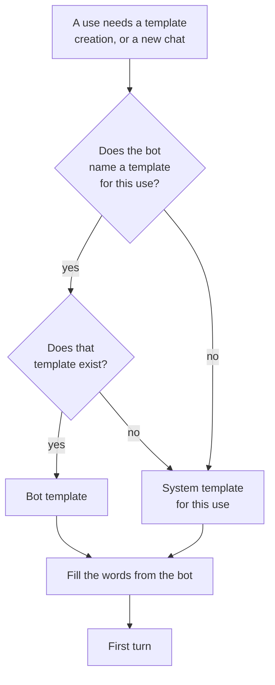
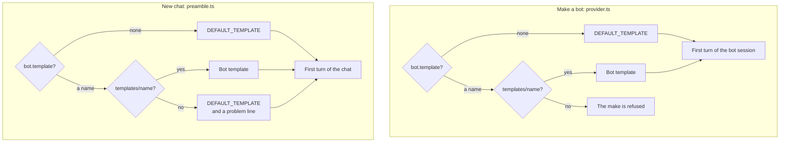

# Bots in ahpd

This file shows how a bot gets the text of its first turns, and where the code differs from the plan Softov gave on 2026-10-14.
It comes from `packages/bot/src` at `040eb7b5`.

## The words

| Word | What it is |
| --- | --- |
| bot | A record of the `bots` collection, at `bot:<id>`. It has a session where it works. |
| bot session | The session the bot gets when it is made. Each chat in it is a chat with the bot. |
| template | Text with the words `{{name}}`, `{{description}}`, `{{instructions}}` and `{{chats}}`. The host fills the words from the bot. |
| bot template | A template that one bot names with its `template` field. It is a record of the `templates` collection. |
| system template | The template a bot gets when it names none. |
| creation template | The template that fills the first turn of the bot session, when the bot is made. |
| chat template | The template that fills the first turn of each new chat in the bot session. |

## The templates as asked

There are two uses: the creation of the bot, and each chat after it.
For each use, the bot's own template comes first, and the system template is the fallback.

- More uses can come later. Each use then has its own bot template and its own system template.
- Today the first use that matters is the chat. The bot chat and the identity of who talks in it do not exist yet.

## The templates as built

One field, `template`, serves both uses.
The system template is `DEFAULT_TEMPLATE`, a constant in [`code://packages/bot/src/template.ts`](../../packages/bot/src/template.ts). An operator cannot change it.

## Gaps

| Asked | Built |
| --- | --- |
| A creation template and a chat template | One `template` field for both uses |
| A system template the operator sets | `DEFAULT_TEMPLATE` in the code |
| A missing bot template falls back to the system template | The chat falls back, and the make is refused |
| Other uses later | No place for a second use |
