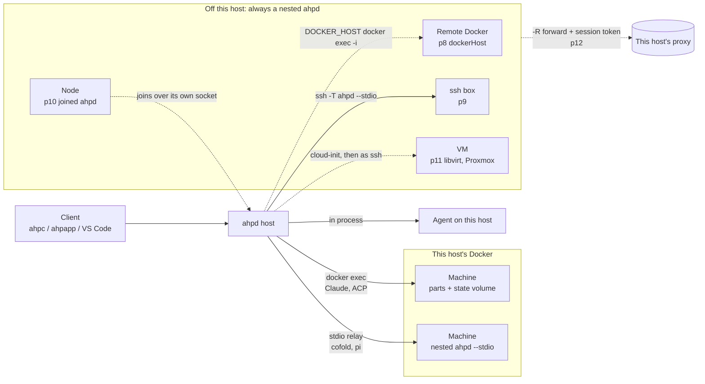
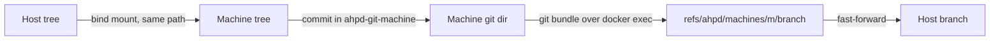
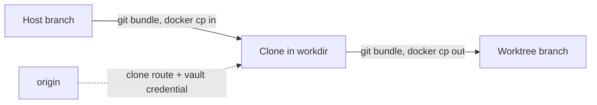
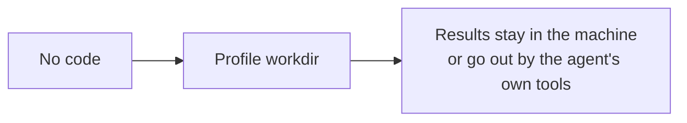

# Computers in ahpd

This file shows where an agent runs, where its code comes from, and where the plans leave a gap.
It comes from `docs/COMPUTER.md` and the container/05 plans p1 to p12, on 2026-10-13.

## The words

| Word | What it is |
| --- | --- |
| host | One ahpd daemon. It owns sessions, chats and turns, and the clients talk to it. |
| computer, machine | A place where an agent can run, at `computer://<id>`. This host is the default computer. |
| runtime | What makes and reaches a machine: `docker` and `devcontainer` today, then `ssh` (p9), a remote Docker (p8), `libvirt` and `proxmox` (p11). |
| profile | A recipe for machines: image, `agents`, `needs`, `state`, `gitGuard`, `sessionTree`, `sessionFolder`. |
| disposable | A profile offered as `disposable:<profile>`. A session makes its machine, and the machine goes after `disposableDelay`. |
| part | The binaries of an agent, mounted at `/opt/ahpd/<part>`, so one plain image runs any agent. |
| state volume | `ahpd-state-...`: the config and sign-in of an agent, per owner or shared by the profile. |
| nested host | A second ahpd in the machine, run as `ahpd --stdio`. The outer host relays the session to it. |
| node, hub | A whole ahpd that joins another (p10). The hub lists the node as a computer. |
| proxy | The model proxy of this host. A machine off this host reaches models through it with a token per session (p12), so no API key leaves this host. |

## Where an agent runs

There are three ways. The agent and the place of the machine choose the way.
Solid lines are built. Dashed lines are planned.

- On this host, Claude and ACP run by `docker exec`. The host keeps the session.
- cofold and pi always run as a nested ahpd, because their tools need a host of their own.
- Off this host, every session is nested, because the terminals and files belong to the other box.

## Where the code comes from

Each row is what the session brings. Each column is where the machine is.

| The session brings | Local Docker (p4-p7) | Remote Docker (p8) | ssh box (p9) | VM (p11) | Node (p10) |
| --- | --- | --- | --- | --- | --- |
| No folder: a bot, an automation | **built**: starts in the `workdir` of the profile; a state volume per owner, or shared with `stateScope: shared` | **not stated**: every route in p8 needs a branch to bundle or clone | **built**: starts in the `workdir` of the machine | **not stated**: reached as p9, so the `workdir` is likely | **planned**: starts in the `workdir` of the node |
| A folder that is not a repository | **built** under `shared`: mounted at the same path; **refused** under `copy` | **refused**: a plain folder has no clone; to copy it in is an idea | **built**: ignored, because a path here is not a path there | **refused**: code arrives by clone only | **planned**: ignored, because `node/open` has no `cwd` |
| A worktree, `isolation: worktree` | **built**: `shared` mounts the tree with its own git directory (`gitGuard: fetch`) and fetches the work back; `copy` uses a checkout of the machine, back only by fetch | **planned**: `bundle` in by `docker cp`, or `clone` from origin; back as a bundle into the worktree branch | **not stated**: p9 has no code route | **planned**: clone, as p8; virtiofs stays open | **not stated**: p10 has no code route |
| A repository folder, `isolation: folder` | **built**: mounted as it is; commits land by fetch on the branch checked out | **open question**: there is no branch of its own; refuse it, or bring the work back to a side branch? | **not stated** | **not stated** | **not stated** |

## How code moves

### Local Docker (built)

The machine sees the tree of this host and commits in a git directory of its own.
This host fetches the work back.

### Remote Docker or VM (planned)

The disk is not shared, so the code goes in and comes out as a bundle.
The `clone` route clones from origin instead.

### Bot with no folder

No code goes in, and the machine starts in the `workdir` of the profile.

## Plan status

| Plan | What | Status |
| --- | --- | --- |
| p1 | A secret reaches a machine by name, never in argv | built |
| p2 | An ACP preset says what its machine needs | built |
| p3 | Parts are built from one versions file | built |
| p4 | A part is mounted into a machine | built |
| p5 | Agents run from their parts and keep their own state | built |
| p6 | The config of an agent is in a volume per profile | built |
| p7 | A worktree brings its repository | built |
| p8 | A profile on another Docker | planned; 7 tasks, one question open |
| p9 | An ssh machine runs a nested host | active; 01-05 done, 06 by hand |
| p10 | A host joins a hub | planned; questions answered |
| p11 | A VM is made for a machine | planned |
| p12 | Machines off this host reach models through the proxy | planned; task 03 can be built |

## Where the plans can go away from the intent

- p8 is written around code. Its routes are bundle and clone, and it refuses a plain folder. A bot with no folder works today on a local Docker and on ssh, but p8 has no row for it.
- p9 and p10 carry no code. They always start in the `workdir` of the box. So a worktree session works on a local and a remote Docker, but not on an ssh box or a node.
- One question has three rules. A local Docker mounts, a remote Docker and a VM clone, and ssh and a node ignore the folder. The open p8 question is one cell of that larger choice.

A simpler model to check against the intent: a machine runs in its `workdir`, unless the session brings a repository.
A repository then reaches the machine one way on every runtime: a mount where the disk is shared, and a bundle where it is not.
