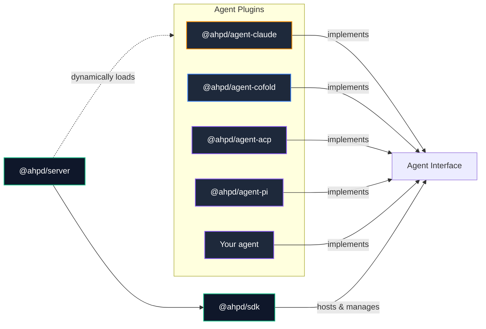

#  ahpd - agent host platform

[](https://github.com/softov/ahpd/actions/workflows/ci.yml)
[](https://www.npmjs.com/package/@ahpd/server)
[](https://www.npmjs.com/package/@ahpd/sdk)
[](https://softov.github.io/ahpd/)


**Run your AI agents anywhere. Control them from anywhere.**

ahpd is an open-source server that brings your AI agents, tools, and projects together.

Run agents on your computer, a remote server, or in containers. Connect from your browser, desktop, terminal, or phone.

Your work stays on the server. You can close an app, switch devices, or disconnect without losing your session.

Built on the [Agent Host Protocol (AHP)](https://microsoft.github.io/agent-host-protocol/). See [AHP compatibility](https://softov.github.io/ahpd/sdk/AHP) for what it implements.

[Read the documentation](https://softov.github.io/ahpd/) · [GitHub](https://github.com/softov/ahpd) · [ahpio.com](https://ahpio.com)

---

## Start in minutes

Install with one line on Linux or macOS:

```bash
curl -fsSL https://ahpio.com/ahpd/install.sh | bash
```

On Windows, in PowerShell:

```powershell
irm https://ahpio.com/ahpd/install.ps1 | iex
```

The script checks for Node 22.18 or newer, installs `@ahpd/server` without sudo, adds `ahpd` to your PATH, and runs `ahpd configure`. [Install options](https://softov.github.io/ahpd/server/INSTALL)

Or install with npm, then run the setup:

```bash
npm install -g @ahpd/server --allow-scripts=node-pty
ahpd configure
```

Choose your agents, network settings, and project folders. To add an agent later, run `ahpd plugin install @ahpd/agent-claude`.

Start the host:

```bash
ahpd start --path /work/project
```

Your host is ready for an AHP client. Connect from the terminal with ahpc:

```bash
npx @softov/ahpc --host ws://127.0.0.1:9187
```

### 🗂️ Serve multiple projects

```bash
ahpd --path /work/api --path /work/web
```

Project paths are catalogue entries, **not filesystem sandboxes**. Access to other paths depends on the configured host capabilities and permissions.

### 🔐 Connect remotely

By default, the host listens on loopback. To listen on another interface, configure a connection token:

```bash
ahpd --host 0.0.0.0 --connection-token-file ~/.config/ahpd/token
```

Only expose the host to networks you trust, and protect the token. See the [remote access documentation](https://softov.github.io/ahpd/server/REMOTE).

---

## Your agents. Your machines. Your control.

AI agents can help you write code, fix problems, manage files, and automate tasks. But they often depend on the terminal or application where you started them.

ahpd gives your agents a place to run and gives you a way to reach them.

**⏳ Keep work running**

Start a task and leave it running on your host. Your agent can continue its work when you close the client. Return later to review the results.

**📱 Work from any device**

Start on your desktop. Check progress from your phone. Open the same session in your browser or terminal. Your work stays in sync.

**🤖 Choose your agents**

Use Claude Code, Codex, Copilot, Gemini, pi, and other supported agents. Configure the agents you need and use them through one host.

**🐳 Run work in isolated environments**

Use Docker containers to give tasks their own environment. Keep work separate when projects need different tools or dependencies.

**⏰ Automate routine tasks**

Schedule agent work or start it from a webhook. Let your host run tasks even when no client is connected.

**🔐 Control access**

Control access to your agents and tools. Define who can interact with your host and what actions they can perform.

**📊 Diagnostics**

Inspect host status, logs, network information, and telemetry.

**💰 Control spending**

See what each person, team, and project has spent on models. Set daily, weekly, or monthly limits, and the host refuses new work when a limit is reached.

**🔀 Share your models**

Point your agent or a script at your host and call any model with your ahpd token. The host uses the provider's key, applies your policies, and records the cost. [Model proxy](https://softov.github.io/ahpd/server/PROXY)

---

## More than a chat

With the right capabilities enabled, agents and clients can work with the same host resources.

**📁 Resources**

Read, write, create, and delete files through resource ports.

**⌨️ Terminals**

Open a shell on your host from any client. Watch the commands your agent runs as they run, and come back later to read their full output.

**🌳 Git & GitHub**

Inspect changes, branches, worktrees, and pull requests. Use separate worktrees to keep parallel sessions from sharing a working tree.

---

## Use the agents you prefer

You do not need to commit to one agent or model provider.

ahpd supports several agent integrations. Each integration runs as a plugin.

[](https://www.npmjs.com/package/@ahpd/agent-claude)

**✻ [`@ahpd/agent-claude`](packages/agent-claude/)**: Run Claude through the Claude Agent SDK. [docs](https://softov.github.io/ahpd/plugins/agent-claude)

```bash
ahpd plugin install @ahpd/agent-claude
```

[](https://www.npmjs.com/package/@ahpd/agent-pi)

**π [`@ahpd/agent-pi`](packages/agent-pi/)**: Run the pi coding agent directly in the host. [docs](https://softov.github.io/ahpd/plugins/agent-pi)
```bash
ahpd plugin install @ahpd/agent-pi
```

[](https://www.npmjs.com/package/@ahpd/agent-acp)

**⇄ [`@ahpd/agent-acp`](packages/agent-acp/)**: Codex, Copilot, Gemini, and other supported agents through Agent Client Protocol. [docs](https://softov.github.io/ahpd/plugins/agent-acp)
```bash
ahpd plugin install @ahpd/agent-acp
```

[](https://www.npmjs.com/package/@ahpd/agent-cofold)

**◈ [`@ahpd/agent-cofold`](packages/agent-cofold/)**: Generic harness to use supported OpenAI-compatible models. [docs](https://softov.github.io/ahpd/plugins/agent-cofold)
```bash
ahpd plugin install @ahpd/agent-cofold
```

---

## Add more with plugins

Each capability can be configured to fit your environment.

[](https://www.npmjs.com/package/@ahpd/computer)

**[`@ahpd/computer`](packages/computer/)**: Create isolated environments for agentic tasks. [docs](https://softov.github.io/ahpd/plugins/computer) 
```bash
ahpd plugin install @ahpd/computer
```

[](https://www.npmjs.com/package/@ahpd/bot)

**[`@ahpd/bot`](packages/bot/)**: Give an agent its own identity, workspace, and session. [docs](https://softov.github.io/ahpd/plugins/bot)
```bash
ahpd plugin install @ahpd/bot
```

[](https://www.npmjs.com/package/@ahpd/webhook)

**[`@ahpd/webhook`](packages/webhook/)**: Start work from an HTTP request. [docs](https://softov.github.io/ahpd/plugins/webhook)
```bash
ahpd plugin install @ahpd/webhook
```

[](https://www.npmjs.com/package/@ahpd/tunnel-devtunnel)

**[`@ahpd/tunnel-devtunnel`](packages/tunnel-devtunnel/)**: Reach your host from VS Code on another network, through a Microsoft Dev Tunnel. [docs](https://softov.github.io/ahpd/plugins/tunnel-devtunnel)
```bash
ahpd plugin install @ahpd/tunnel-devtunnel
```

[](https://www.npmjs.com/package/@ahpd/tasks)

**[`@ahpd/tasks`](packages/tasks/)**: Keep one list of tasks and plans that every agent and person reads and writes. [docs](https://softov.github.io/ahpd/plugins/tasks)
```bash
ahpd plugin install @ahpd/tasks
```

[](https://www.npmjs.com/package/@ahpd/push)

**[`@ahpd/push`](packages/push/)**: Get a phone notification when a session needs you, with the app closed. [docs](https://softov.github.io/ahpd/plugins/push)
```bash
ahpd plugin install @ahpd/push
```

[](https://www.npmjs.com/package/@ahpd/activepieces)

**[`@ahpd/activepieces`](packages/activepieces/)**: Use Activepieces connectors as tools for your sessions and bots. [docs](https://softov.github.io/ahpd/plugins/activepieces)
```bash
ahpd plugin install @ahpd/activepieces
```

---

## One host. Many clients.

ahpd runs your agents and keeps their sessions. Connect with the client that suits you.

### 🌐 Browser → @ahpd/web
Manage sessions, files, terminals, and host settings from your browser.

[GitHub](https://github.com/softov/ahpw) · [Releases](https://github.com/softov/ahpw/releases)

### 🖥️ Desktop → ahp-desk
Connect to multiple hosts, manage local installations, and work in dedicated windows.

[GitHub](https://github.com/softov/ahp-desk) · [Download](https://github.com/softov/ahp-desk/releases)

### 💻 Terminal → @softov/ahpc
Work with agents through an interactive terminal, CLI commands, or scripts.

```bash
# Connect to your host with the terminal client
npx @softov/ahpc --host <host-address> --token <your-token>
```

[GitHub](https://github.com/softov/ahpc) · [Releases](https://github.com/softov/ahpc/releases)

### 📱 Mobile → AgentHost Client
Follow work, receive notifications, and respond when an agent needs your approval.

[Android](https://play.google.com/store/apps/details?id=com.agenthostclient.app) · iOS soon · [Website](https://agenthostclient.com)

### 🔌 Other AHP clients
Connect with compatible applications, including supported VS Code integrations.

[AHP Client Libraries](https://microsoft.github.io/agent-host-protocol/guide/clients.html) · [AHP Implementations](https://microsoft.github.io/agent-host-protocol/guide/implementations.html)

---

**One host, every screen.** Start work on one device and continue from another. Your sessions stay on the host.

---

## Make it your own

ahpd has a small core and a plugin system. Add new agents, tools, URI schemes, environments, and services without modifying the daemon.

### 🧰 Build with the SDK

[`@ahpd/sdk`](https://www.npmjs.com/package/@ahpd/sdk) lets you embed an AHP host in your application. It handles protocol negotiation, subscriptions, snapshots, state updates, reconnects, sessions, chats, and transcript paging.

```ts
import { createHost, listen } from '@ahpd/sdk';
import { claude } from '@ahpd/agent-claude';

const path = process.cwd();
const host = createHost({ path, agents: [claude({ paths: [path] })] });
await listen({ port: 9187 }, (peer) => host.accept(peer));
```

[Build your own host](https://softov.github.io/ahpd/sdk/BUILD-A-HOST)

### 🧩 Write plugins and agents

You can extend your host without changing the server itself.

Implement the `Agent` interface or contribute host ports, tools, and URI schemes. Load extensions from npm packages, local directories, or manifest-backed files.

```bash
# Load plugins for one run, in place of the configured list
ahpd --plugin @ahpd/agent-claude --plugin @ahpd/computer
# A single file, with a plugin.json beside it that names its id and main
ahpd --plugin ./scratch-agent.mjs
# A directory with a manifest, tried against the working directory first
ahpd --plugin ./my-custom-agent
```

A custom agent implements the same `Agent` interface and is named the same way as the agents above. A client speaks only AHP and depends on no agent SDK.



> Plugins execute inside the daemon with its permissions: install only code you trust.
> Add the integrations you need. Remove or disable the ones you do not use.

[Write a plugin](https://softov.github.io/ahpd/plugins/PLUGINS) · [Write an agent](https://softov.github.io/ahpd/sdk/AGENT) · [Smallest agent example](examples/echo)

---

## Documentation

The full documentation is at [softov.github.io/ahpd](https://softov.github.io/ahpd/).

| Document | Purpose |
| --- | --- |
| [Get started](docs/server/GET-STARTED.md) | Install, configure, start, and connect VS Code |
| [Install](docs/server/INSTALL.md) | Install, and run on Node, Bun or Deno |
| [Upgrade](docs/server/UPGRADE.md) | Upgrade the daemon and its plugins |
| [Reference](docs/server/REFERENCE.md) | Every command and flag |
| [Plugins](docs/server/PLUGINS.md) | Install, update, and configure plugins |
| [Users](docs/server/USERS.md) | Users and authorization |
| [Policy](docs/sdk/POLICY.md) | Who may use which agent, model and computer, and how much |
| [Usage](docs/server/USAGE.md) | What each person, team and project has spent |
| [Model proxy](docs/server/PROXY.md) | Call a model through the host with your ahpd token |
| [Write a plugin](docs/plugins/PLUGINS.md) | The plugin contract, manifest and events |
| [Write an agent](docs/sdk/AGENT.md) | The `Agent` and `Session` contracts |
| [Build your own host](docs/sdk/BUILD-A-HOST.md) | `createHost` and the ports |
| [AHP compatibility](docs/sdk/AHP.md) | What this host implements of AHP, command by command |

Every document is listed in [docs/README.md](docs/README.md), one line each.

---

## Development

Tips, PRs, and contributions are welcome!

Read [DEVELOPER.md](DEVELOPER.md) for detailed development guidelines.

Discuss development, issues, and ideas on the [GitHub Discussions](https://github.com/softov/ahpd/discussions) page.

Any development starts with cloning or forking the repository and installing dependencies.

```bash
git clone https://github.com/softov/ahpd
cd ahpd

pnpm install
pnpm build

pnpm test
pnpm typecheck
```

Protocol captures can be checked against the strict schema:

```bash
pnpm wire -- packages/sdk/test/fixtures/wire.jsonl
```

---

## Open source. Built for choice.

ahpd is open source and released under the MIT license.

Run it on your own infrastructure. Choose your agents, configure your tools, and build the environment that works for you.

Use it for a personal project, a development team, or an application that needs agent capabilities.

**Your infrastructure. Your agents. Your workflow.**

ahpd is part of ahpio, the Agent Host Platform. Get to know the whole platform at [ahpio.com](https://ahpio.com).

[Documentation](https://softov.github.io/ahpd/) · [Source Code](https://github.com/softov/ahpd) · [ahpio.com](https://ahpio.com)